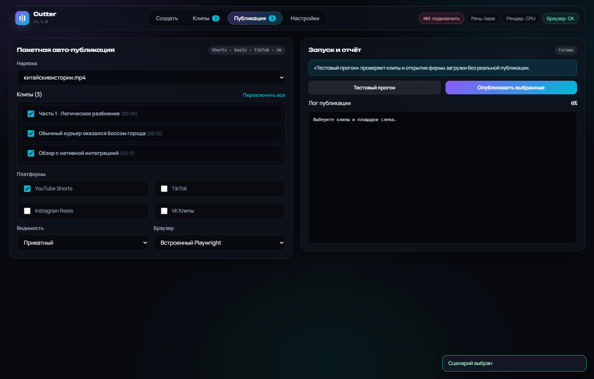
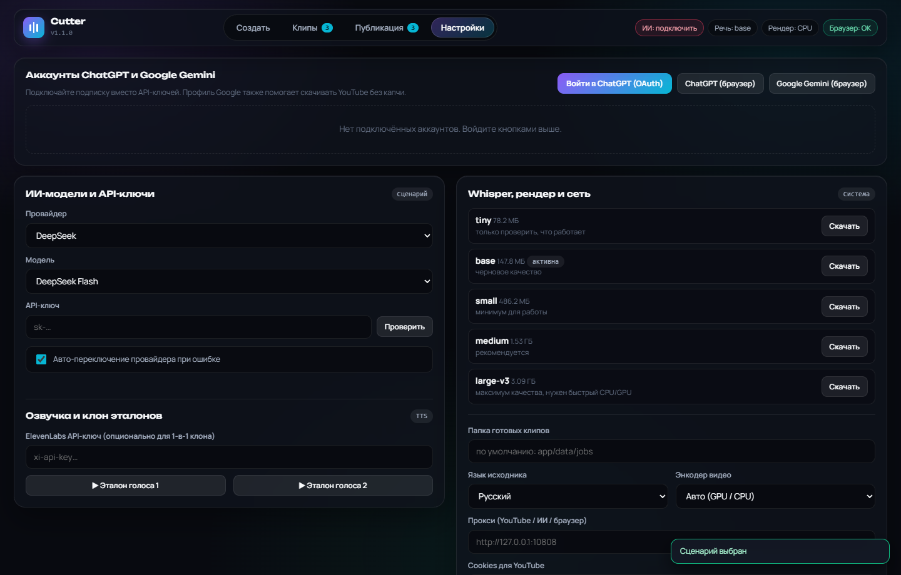

<div align="center">

# Cutter

**Длинное видео → вертикальные шортсы, серии по частям и озвучка дорам. Одним локальным окном.**

Локальное настольное приложение на Windows: `ffmpeg` + `faster-whisper` + LLM по подписке (ChatGPT Plus/Pro, Google Gemini) или API + нейро-озвучка + пакетная автопубликация на площадки.


</div>

---

## Что нового в 1.1.0

- **Аккаунты по подписке вместо API-ключей.** Вход в **ChatGPT Plus/Pro** (OAuth PKCE или браузер) и **Google Gemini** (браузерная сессия; сохранённый Google-профиль также помогает обходить проверку «вы не робот» при скачивании YouTube).
- **Три режима нарезки и расширенные тайминги.**
  - **Умные моменты** — ИИ ищет сильные хуки, сюжетные повороты и кульминации (`15–35с`, `18–60с`, `30–75с`, `45–120с` или свой От/До, до 20 клипов).
  - **Сериал по частям** — ровное разбиение длинного видео на логические серии «Часть 1 / 2 / 3…» строго по границам предложений (`15с` / `30с` / `45с` / `60с` / `90с` или ползунок до 3 минут).
  - **Китайская дорама + озвучка** — ИИ-пересказ реплик, склейка коротких фраз, чистый голос рассказчика без искажения формант (`Рассказчик · Канон 1 / 2`, женский, английский), 3 каноничных фоновых трека (`drama-guzheng`, `brainrot-twist`, `imperial-destiny`), стиль субтитров **Дорама** и опциональное клонирование эталонов 1-в-1 через ElevenLabs.
- **Рекламные интеграции.** Вшивание промо-роликов `.mp4` (до видео / после хука / в конец) и наложение баннеров `.png` (сверху / снизу) прямо при сборке или пакетно на уже готовые клипы.
- **Новый интерфейс Aurora Bento Studio.** Живой предпросмотр `9:16` (воспроизводит выбранный локальный видеофайл прямо внутри рамки телефона), схемы кадрирования (`Авто`, `Размытие`, `Кроп`, `Чёрный`, `Оригинал`), превью стилей субтитров, прослушка голоса и фоновой музыки в один клик, встроенный плеер и перерезка таймингов на вкладке **Клипы**.
- **Аппаратный рендер и устойчивый YouTube.** Автоопределение `NVENC` / `QSV` / `AMF` / CPU, каскад `force_ipv4` + перебор `player_client` + cookies профиля браузера + прокси и DoH.

<table>
<tr>
<td></td>
<td></td>
</tr>
<tr>
<td align="center"><em>галерея клипов, встроенный плеер и перерезка</em></td>
<td align="center"><em>пакетная публикация на Shorts / TikTok / Reels / VK</em></td>
</tr>
</table>

---

## Демо-рендеры

В папке [`demo/`](demo) собраны готовые рендеры `1080×1920`, демонстрирующие стили оформления и новые режимы:

- **[demo_07_parts_split.mp4](demo/demo_07_parts_split.mp4)** — последовательное разбиение на логические части
- **[demo_08_brainrot_drama.mp4](demo/demo_08_brainrot_drama.mp4)** — пересказ китайской ИИ-дорамы с чистой озвучкой рассказчика, музыкой и титрами
- **[demo_09_ad_integration.mp4](demo/demo_09_ad_integration.mp4)** — видео-врезка после хука и нижний рекламный баннер
- **[all-in-one.mp4](demo/all-in-one.mp4)** + **[contact-sheet.png](demo/contact-sheet.png)** — 6 базовых стилей субтитров, цветокора (`Кино`, `Аура`, `VHS`, `Тёплый`, `Ч/Б`) и оригинальной музыки (`demo_01`..`demo_06`)

Пересобрать демо: `python tools/make_new_demos.py` и `python tools/make_demo.py`.

---

## Установка и запуск

### Портативная версия или MSI (Windows x64)

1. Открой [Releases](../../releases):
   - **Портативный архив (рекомендуется):** скачай `Cutter-1.1.0-windows-x64.zip`, распакуй и запусти `Cutter.exe`. Браузеры не блокируют ZIP-архив так строго, как неподписанный `.msi`.
   - **Установщик Windows:** скачай `Cutter-1.1.0-x64.msi` — ставится per-user в `%LOCALAPPDATA%\Programs\Cutter` без прав администратора и создаёт ярлыки в меню Пуск и на рабочем столе.
2. При первом запуске открой **Настройки**, скачай модель Whisper (`base` или `medium`) и подключи ChatGPT / Google или вставь API-ключ LLM.

### Запуск из исходников

Нужны **Python 3.11+** и **ffmpeg** в `PATH`:

```bat
git clone https://github.com/hvhboynixware-ui/cutter.git
cd cutter
run.bat
```

`run.bat` создаст `.venv`, поставит зависимости из `requirements.txt` и откроет окно. Режимы запуска вручную:

```powershell
.\.venv\Scripts\python -m app.main                     # нативное окно Cutter.exe (WebView2)
.\.venv\Scripts\python -m app.main --window-mode app    # окно Edge/Chrome без адресной строки
.\.venv\Scripts\python -m app.main --window-mode browser # вкладка браузера
.\.venv\Scripts\python -m app.main --window-mode none    # только сервер 127.0.0.1:8765
```

### Самостоятельная сборка приложения и MSI

```powershell
powershell -ExecutionPolicy Bypass -File tools\build_app.ps1      # -> dist\Cutter\ (~755 МБ)
powershell -ExecutionPolicy Bypass -File installer\build.ps1      # -> dist\Cutter-1.1.0-x64.msi
```

---

## Настройки, аккаунты и провайдеры



| Способ подключения ИИ | Что нужно | Особенности |
|---|---|---|
| **ChatGPT Plus / Pro** | Кнопка `Войти в ChatGPT (OAuth)` или `(браузер)` | Без API-ключа, по вашей подписке |
| **Google Gemini** | Кнопка `Google Gemini (браузер)` | Без API-ключа + cookies для обхода проверки YouTube |
| **DeepSeek / OpenRouter / Gemini API / Groq** | API-ключ в Настройках | Низкая цена / бесплатные лимиты + авто-фолбэк |
| **Ollama / Свой `/v1`** | Адрес сервера (`http://127.0.0.1:11434/v1` и др.) | Полностью локальная работа |

Модели **Whisper** (`tiny` 78 МБ .. `large-v3` 3.09 ГБ) загружаются напрямую с ModelScope.

---

## Как устроено под капотом

```text
файл / YouTube / Rutube / VK
      │
      ▼
   ffmpeg ──► wav 16 kHz (+ авто-выбор NVENC / QSV / AMF / CPU)
      │
      ▼
faster-whisper (локально) ──► сегменты + пословные таймкоды
      │
      ├── режим Моменты ──► LLM выбирает хуки, заголовки, скор и хештеги
      ├── режим По частям ──► разбиение на серии по границам предложений
      └── режим Дорама TTS ──► пересказ LLM + озвучка рассказчиком (Edge / ElevenLabs / Piper)
      │
      ▼
ffmpeg один проход ──► 1080×1920, блюр/кроп/чёрный, FX-цветокор, анти-дубль,
                      ASS-субтитры, дакинг музыки, рекламная вставка/баннер
      │
      ▼
Playwright / Dolphin Anty / AdsPower ──► YouTube Shorts / TikTok / Instagram Reels / VK Клипы
```

Ключевые модули:

- `app/main.py` / `app/server.py` / `app/jobs.py` — нативное окно, FastAPI `127.0.0.1:8765`, очередь фоновых задач
- `app/core/accounts.py` — OAuth PKCE и Playwright-сессии аккаунтов ChatGPT и Google
- `app/core/pipeline.py` — транскрибация, нарезка по частям, субтитры и рендер клипов
- `app/core/tts.py` — склейка реплик, эталонные голоса, клон ElevenLabs и офлайн Piper
- `app/core/integrator.py` — вшивание рекламных роликов `.mp4` и баннеров `.png`
- `app/core/effects.py` + `app/assets/music/` — цветофильтры, защита от повторов и оригинальная музыка
- `app/core/upload/` — пакетная публикация через встроенный Playwright, Dolphin Anty или AdsPower

---

## Разработка и тесты

```powershell
.\.venv\Scripts\python -m ruff check app --select E9,F
node --check app\web\assets\app.js
.\.venv\Scripts\python -m pytest app/tests -q   # 184 офлайн-теста
```

Стек: FastAPI + Uvicorn, C#/WebView2 (`app/window/CutterWindow.cs`), ванильный HTML/CSS/JS без сборщика.

---

## Честные ограничения

- Автоматизация публикации на площадки зависит от текущей вёрстки студий (`app/core/upload/selectors.py`); перед боевой загрузкой проверяйте «Тестовый прогон (Dry Run)».
- Whisper на CPU работает примерно в `1×` реального времени на `medium`; GPU CUDA для Whisper включается флагом `CUTTER_USE_CUDA=1`.
- Права на исходные видеоматериалы остаются на ответственности пользователя.

---

## Лицензия

MIT.
