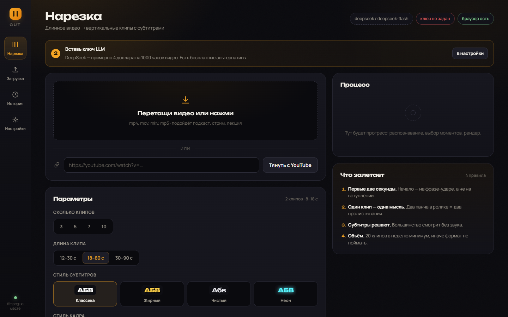
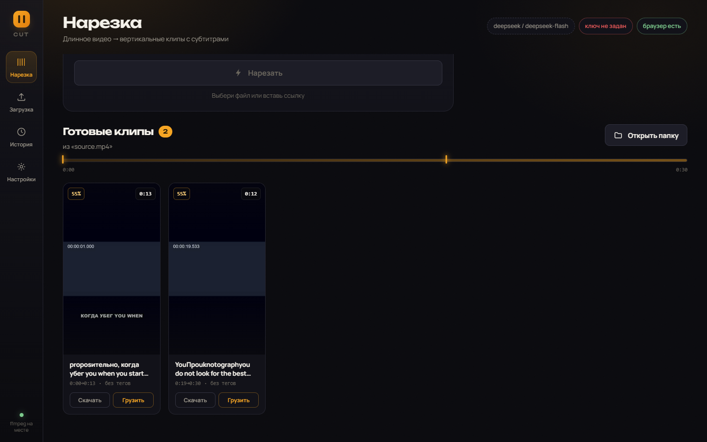
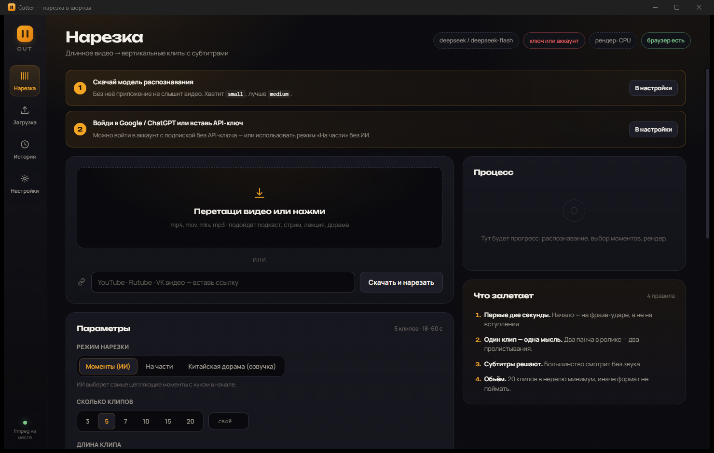

<div align="center">

# Cutter

**Длинное видео → вертикальные шортсы с субтитрами. Одним окном, без облака.**

Локальное приложение: ffmpeg + faster-whisper + LLM на выбор + автозагрузка на площадки
через обычный браузер или профиль антидетекта.



</div>

---

## Что умеет

- **Перетащил файл — получил клипы.** Подкаст, стрим, лекция, фильм — неважно.
- **Ссылка YouTube.** Кнопка «Тянуть с YouTube» качает и сразу нарезает.
- **Субтитры прожигаются в кадр.** 4 стиля, автоматические переносы, синхрон со словами.
- **Умный выбор моментов.** LLM читает транскрипт и отдаёт: таймкоды, хук, заголовок, хэштеги и оценку «залетит / не залетит».
- **Стиль кадра в один клик.** Кино (teal-orange + виньетка), Аура (тёплый свет), Тёплый, VHS (зерно и рассинхрон), Ч/Б — кнопками перед рендером.
- **Своя музыка без claim'ов.** Пак оригинальных процедурных треков (lofi, cinematic, podcast, trap и т.д.), подмешивается с авто-дакингом речи — кнопками и ползунком громкости.
- **Защита от повторов.** Лёгкая/сильная: флип кадра, микро-зум, +2–3% скорости, зерно — ролик перестаёт быть байт-в-байт копией исходника, чтобы не прилетало «повторный контент».
- **Метрики по клипам.** Скор, длительность, слов в минуту, эффект, музыка — и суммарная статистика по всей пачке.
- **Вертикальный формат 1080×1920.** Горизонтальные исходники — с размытым фоном, вертикальные — кропом.
- **Загрузка по кнопке.** TikTok, YouTube Shorts, VK Клипы — через Playwright, с сохранённым логином.
- **Антидетект по желанию.** Dolphin Anty и AdsPower подключаются по CDP: их фингерпринт, их прокси.
- **Режим тренировки.** Доводит до кнопки публикации и не нажимает — чтобы сначала проверить.
- **Пять LLM-провайдеров** с фолбэком: DeepSeek, OpenRouter, Gemini, Groq, локальная Ollama.
- **Всё локально.** Видео, ключи, музыка и история — на твоём диске; наружу уходит только запрос к LLM.

<table>
<tr>
<td></td>
<td></td>
</tr>
<tr>
<td align="center"><em>результат нарезки</em></td>
<td align="center"><em>публикация по кнопке</em></td>
</tr>
</table>

---

## Установка

### Готовый инсталлер (для пользователей)

1. Скачай `Cutter-1.0.0-x64.msi` из [Releases](../../releases) и запусти.
2. Ярлык появится в меню Пуск и на рабочем столе.
3. Первый запуск: скачай модель распознавания в Настройках и вставь ключ LLM — приложение подскажет.

Ставится и удаляется штатно через «Программы и компоненты». ffmpeg уже внутри, ничего докачивать не нужно.

### Портативная версия

Распакуй `Cutter-1.0.0-windows-x64.zip` в любую папку и запусти `Cutter.exe`.
Данные (настройки, модели, клипы) хранятся в `%LOCALAPPDATA%\Cutter`.

### Из исходников

Нужны **Python 3.11+** и **ffmpeg** в `PATH` (проверка: `ffmpeg -version`).

```bat
git clone https://github.com/hvhboynixware-ui/cutter.git
cd cutter
run.bat
```

`run.bat` сам создаст `.venv`, поставит зависимости и откроет окно.
Для разработки окно собирается отдельно: `tools\build_window.ps1` (C# компилируется `csc.exe` из Windows, ничего ставить не надо).

Режимы окна, если что-то не поднимается:

```powershell
.\.venv\Scripts\python -m app.main                     # авто: нативное окно Cutter.exe
.\.venv\Scripts\python -m app.main --window-mode app    # окно Edge/Chrome без адресной строки
.\.venv\Scripts\python -m app.main --window-mode browser # обычная вкладка
.\.venv\Scripts\python -m app.main --window-mode none    # только сервер, для отладки UI
```

### Собрать приложение самому

```powershell
tools\build_app.ps1      # -> dist\Cutter\ (окно + бэкенд + ffmpeg), ~700 МБ
installer\build.ps1      # -> dist\Cutter-1.0.0-x64.msi
```

Нужен `pip install pyinstaller` в venv. MSI собирается WiX v3 (portable, кладётся в `tools\wix`),
права администратора для сборки и установки не требуются: установка per-user.

---

## Как устроено окно



```
Cutter.exe  (C#, 37 КБ)          cutter_backend.exe  (Python, PyInstaller)
  ├─ запускает бэкенд               ├─ FastAPI на 127.0.0.1:8765
  ├─ ждёт /api/health               ├─ пайплайн: ffmpeg + whisper + LLM
  ├─ открывает WebView2-окно        └─ Playwright для загрузки на площадки
  └─ гасит бэкенд при закрытии
```

Почему так: WebView2 уже есть в Windows 10/11, поэтому окно нативное и весит копейки.
`.NET Framework 4.8` + `csc.exe` тоже есть в системе — сборка окна не требует SDK.
Если WebView2-рантайма вдруг нет, `Cutter.exe` покажет ссылку на установку.

---

Можно и вручную:

```powershell
python -m venv .venv
.\.venv\Scripts\pip install -r requirements.txt
.\.venv\Scripts\python -m app.main
```

### 1. Модель распознавания

Открой **Настройки → Слух** и скачай модель кнопкой. Рекомендуется `medium`.

| Модель | Размер | Когда |
|---|---|---|
| `tiny` | 75 МБ | только проверить, что всё живо |
| `base` | 138 МБ | черновое качество |
| `small` | 500 МБ | минимум для работы |
| `medium` | 1.5 ГБ | **рекомендуется** |
| `large-v3` | 3 ГБ | максимум качества |

Модели тянутся с ModelScope — из РФ работает без VPN (HuggingFace отдаёт 403 на CDN).

### 2. Ключ LLM

**Настройки → Мозги**, вставь ключ и нажми «Проверить».

| Провайдер | Модель по умолчанию | Цена | Ключ |
|---|---|---|---|
| **DeepSeek** | `deepseek-flash` | ~$0.004 за час видео | [platform.deepseek.com](https://platform.deepseek.com/api_keys) |
| OpenRouter | `deepseek/deepseek-chat-v3-0324:free` | бесплатно | [openrouter.ai](https://openrouter.ai/keys) |
| Gemini | `gemini-2.0-flash` | есть бесплатный лимит | [aistudio.google.com](https://aistudio.google.com/apikey) |
| Groq | `llama-3.3-70b-versatile` | бесплатный лимит | [console.groq.com](https://console.groq.com/keys) |
| Ollama | `llama3.1` | бесплатно, локально | [ollama.com](https://ollama.com) |

Хватает DeepSeek: 30 юаней — это примерно 500–1000 часов анализа видео.
Если провайдер отвалился, включённый фолбэк пробует следующий по цепочке.

---

## Как это работает

```
файл / YouTube
      │
      ▼
   ffmpeg ──► wav 16 kHz
      │
      ▼
faster-whisper (локально) ──► сегменты + слова с таймингами
      │
      ▼
LLM ──► моменты: start/end + хук + заголовок + хэштеги + оценка
      │
      ▼
ffmpeg ──► 1080×1920, блюр-фон, эффект кадра, защита от повторов,
           ASS-субтитры, музыка с дакингом, loudnorm
      │
      ▼
clip_01.mp4 + превью + clips.json
      │
      ▼
Playwright ──► TikTok / YouTube Shorts / VK Клипы
```

Эффекты и музыка — обычные ffmpeg-фильтры в `app/core/effects.py`: один проход рендера,
никаких внешних библиотек и GPU. Пак музыки лежит в `app/assets/music/`, каждый трек —
процедурный синтез (`tools/make_music.py`), поэтому права наши и Content ID молчит.

Ключевые файлы:

```
app/
  main.py               окно + локальный сервер
  server.py             HTTP API (только 127.0.0.1)
  jobs.py               очередь задач, прогресс, отмена
  core/
    pipeline.py         нарезка: звук → транскрипт → рендер
    llm.py              провайдеры LLM и выбор моментов
    youtube.py          yt-dlp
    models.py           скачивание whisper-моделей
    settings.py         настройки и пути
    upload/
      browsers.py       Playwright + Dolphin + AdsPower
      selectors.py      селекторы страниц (списки с фолбэками)
      tiktok.py / youtube.py / vk.py
  web/                  интерфейс (ванильный HTML/CSS/JS)
  tests/                84 офлайн-теста
```

---

## Загрузка на площадки

Движки:

| Движок | Что это | Логин |
|---|---|---|
| **Встроенный** | Playwright + локальный профиль `app/data/browser_profiles/` | сохраняется между запусками |
| **Dolphin Anty** | поднимаем профиль через локальный API и цепляемся по CDP | твой профиль Dolphin |
| **AdsPower** | то же через `local.adspower.net:50325` | твой профиль AdsPower |

Для антидетекта: запусти клиент, выбери движок, нажми «Обновить» — профили подтянутся списком.
Прокси и фингерпринт остаются родные, из профиля антидетекта.

**Первый запуск:** включи «Режим тренировки» — приложение откроет браузер, загрузит видео,
заполнит описание и остановится перед публикацией. Проверь глазами, потом выключай тренировку.

Селекторы лежат в `app/core/upload/selectors.py` — списками кандидатов.
Площадки меняют вёрстку; когда селектор отвалится, приложение вернёт понятную ошибку и скриншот
в `app/data/shots/`, а правка нужна в одном файле.

---

## Настройки и файлы

- Настройки: `%LOCALAPPDATA%\Cutter\data\settings.json` (в исходниках — `app/data/settings.json`); ключи тоже там, в git не попадают
- Результаты: `…\Cutter\data\jobs\<id>\clips\` — `clip_01.mp4`, превью, `clips.json`
- Скриншоты ошибок загрузки: `…\Cutter\data\shots\`
- Модели: `…\Cutter\models\faster-whisper-<size>\`

Переменные окружения:

| Переменная | Что делает |
|---|---|
| `CUTTER_DATA_DIR` | переопределить папку данных (по умолчанию `%LOCALAPPDATA%\Cutter`) |
| `CUTTER_USE_CUDA=1` | включить GPU для whisper (по умолчанию CPU int8 — работает везде) |
| `CUTTER_FAKE_LLM=1` | демо-режим: моменты без LLM, для проверки пайплайна |
| `CUTTER_YOUTUBE_VISIBILITY` | `public` / `unlisted` / `private` для YouTube |
| `DOLPHIN_API`, `ADSPOWER_API` | адреса локальных API антидетектов |
| `CUTTER_BROWSER_CHANNEL` | `chrome` или `msedge`, если автопоиск ошибся |

---

## Разработка

```powershell
.\.venv\Scripts\python -m pytest app/tests -q     # 84 теста, офлайн
.\.venv\Scripts\python -m app.main --no-window     # только сервер, для отладки UI
.\.venv\Scripts\python tools\e2e_check.py          # e2e по HTTP на тестовом видео
```

Стек: FastAPI + Uvicorn для API, C#/WebView2 для нативного окна, ванильный фронтенд без сборки.
Шрифты лежат локально (`tools/fetch_fonts.py` — обновить при необходимости).

---

## Честные ограничения

- **Селекторы площадок не проверены на живых аккаунтах** — только логика и фолбэки. Первые загрузки делай в режиме тренировки.
- **Whisper на CPU** идёт примерно 1× реального времени на `medium`. GPU включается флагом, но ctranslate2 требует cublas — не на каждой машине заведётся.
- **Права на контент за тобой.** Нарезка чужих фильмов и музыки — это страйки и блокировки; бери материалы, где права улажены, или свои.
- **Автоматизация площадок** может расходиться с их правилами. Аккаунты — твоя ответственность, режим тренировки для того и сделан.
- Windows-only проверено; на Linux/macOS запустится, но окно через pywebview может потребовать пакетов системы.

---

## Лицензия

MIT. Делай что хочешь, только не продавай как своё.
